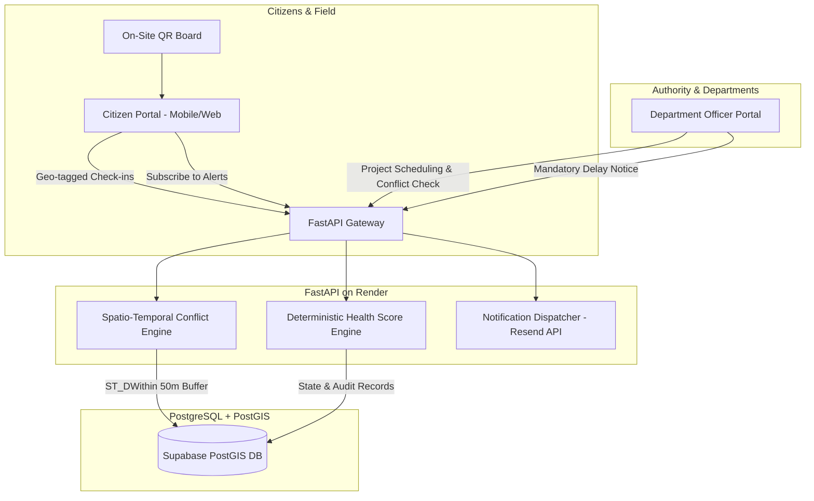

# 🚧 DigOnce — Public Works Coordination & Civic Accountability Platform

[](https://civictech-frontend-ud13.onrender.com/)
[](https://civictech-public-works.onrender.com/api/v1/health)
[](https://civictech-public-works.onrender.com/docs)
[](https://github.com/Bhavithran-BK/civictech-public-works)

> **Eliminating duplicate digging, coordinating multi-department utility cuts, and restoring civic transparency.**

---

## 🌐 Public Deployed Links

| Service | Public URL | Description |
| :--- | :--- | :--- |
| **🚀 Live Citizen & Authority Portal** | **[https://civictech-frontend-ud13.onrender.com/](https://civictech-frontend-ud13.onrender.com/)** | Full interactive Next.js web application |
| **⚙️ Live Backend REST API** | **[https://civictech-public-works.onrender.com/api/v1](https://civictech-public-works.onrender.com/api/v1)** | FastAPI coordination engine & spatial endpoints |
| **📖 Interactive API Docs (Swagger)** | **[https://civictech-public-works.onrender.com/docs](https://civictech-public-works.onrender.com/docs)** | Interactive Swagger UI testing interface |
| **🩺 System Health Check** | **[https://civictech-public-works.onrender.com/health](https://civictech-public-works.onrender.com/health)** | Live service status probe (`{"status":"ok"}`) |

---

## 🔑 Demo Access Credentials for Judges

Test the Department Officer and Administrator workflows with zero setup:

| Role | Email | Password | Department Scope |
| :--- | :--- | :--- | :--- |
| **Department Officer** | `officer.roads@cityworks.gov` | `admin123` | Greater Chennai Corporation (GCC - Roads & Bridges) |
| **System Admin** | `admin@cityworks.gov` | `admin123` | All Municipal Departments & Cross-Agency Oversight |

*(A **"1-Click Demo Login"** button is also available directly inside the application for instant access).*

---

## 💡 The Problem

Every year, municipal corporations spend thousands of crores resurfacing asphalt roads—only for water, electricity, or telecom utilities to dig them up weeks later.
* **No Spatio-Temporal Visibility**: Departments plan infrastructure work in silos without cross-agency coordination.
* **Wasted Public Capital**: Taxpayer funds are repeatedly destroyed repaving the same trenches.
* **Zero Accountability**: Inactive or abandoned "ghost" construction sites remain stalled indefinitely without citizen recourse.

---

## ⚡ The DigOnce Solution

DigOnce acts as a unified digital clearinghouse and civic verification platform for city works:

1. **Spatio-Temporal Trench Conflict Engine**:
   When an agency plans a project, our PostGIS geometry engine checks a **50-meter buffer** against active and recent corridor digs within 90 days. It warns planners of clashes, computes **avoidable repaving cost**, and recommends joint work windows.
2. **Citizen Field Verification Loop**:
   Residents scan a physical site board **QR code** to verify ground reality. Geo-fenced check-ins (`progress_verified`, `no_activity`, `safety_hazard`) directly impact the contractor's accountability score.
3. **Dynamic Health Score & "Stalled" Auto-Flagging**:
   Deterministic health scoring docks points for schedule slippage, lack of updates, and unverified work. Projects with $< 35\%$ score or $\ge 3$ consecutive "no activity" audits automatically flip to a public **STALLED** badge.
4. **Mandatory Delay Accountability**:
   Contractors and officers cannot postpone an end date without a logged technical justification.
5. **Real-time Email Notifications via Resend**:
   Citizens subscribe to project dossiers and receive automated alerts on delays, milestone logs, and work completions.

---

## 🏗️ System Architecture



---

## 🌟 Key Features Walkthrough

### 1. Interactive Public GIS Map
* Live corridor polylines color-coded by real-time status:
  * 🟢 **On Track** ($\ge 70\%$ Health Score)
  * 🟡 **At Risk** ($50\% - 69\%$)
  * 🔴 **Delayed** (Formal schedule extension active)
  * 🚨 **Stalled** (Verified inactive or health $< 35\%$)
* Real-time category filtering across **Roads, Water Pipelines, Stormwater Drains, Electricity, Telecom, and Metro Rail**.

### 2. Comprehensive Project Dossiers (`/projects/[id]`)
* Shareable accountability URL with dynamically generated QR codes for on-site physical boards.
* Printable dossier summary (`Print Dossier`).
* Official progress logs, mandatory delay histories, and citizen verification photo threads.
* Instant email subscription for live project milestone alerts.

### 3. Authority Planning & Clash Detection (`/dept/projects/new`)
* Interactive geometry drawing tool with instant spatial clash detection against overlapping projects.
* Real-time calculation of **Avoidable Municipal Cost** in Lakhs/Crores.

### 4. Authority Executive Dashboard (`/dept/dashboard`)
* City-wide KPI cards: Total Projects, Overdue Count, Open Field Reports, and Estimated Duplicate-Dig Savings.
* Departmental workload breakdown and quick-action project management.

---

## 🛠️ Tech Stack & Implementation Details

* **Frontend**: Next.js 16 (App Router, Turbopack), React 19, Tailwind CSS, Leaflet GIS (`react-leaflet`), Lucide Icons, Canvas Confetti.
* **Backend**: FastAPI (Python 3.12), Pydantic v2, Uvicorn, PostGIS & Shapely spatial operations, APScheduler.
* **Database**: PostgreSQL 15 + PostGIS spatial extensions (hosted on Supabase).
* **Email Service**: Resend Transactional Email API.
* **Hosting**: Render Cloud (FastAPI Backend + Next.js Frontend).

---

## 🧪 Local Setup & Development

### Prerequisites
* Node.js 18+ and npm
* Python 3.11+
* Git

### 1. Clone the Repository
```bash
git clone https://github.com/Bhavithran-BK/civictech-public-works.git
cd civictech-public-works
```

### 2. Backend Setup
```bash
cd backend
python -m venv env
# Windows:
.\env\Scripts\activate
# Linux/macOS:
# source env/bin/activate

pip install -r requirements.txt
python -m uvicorn app.main:app --reload --port 8000
```
API runs locally at `http://localhost:8000` (docs at `http://localhost:8000/docs`).

### 3. Run Backend Test Suite
```bash
pytest tests/
```
Output: **66 passed tests** covering:
- Authentication, JWT verification, and role security
- PostGIS corridor spatial buffer calculations
- Health score and auto-stalled transitions
- Mandatory delay validations and notifications

### 4. Frontend Setup
```bash
cd ../frontend
npm install
npm run dev
```
Open `http://localhost:3000` in your browser.

---

## 📈 Municipal Feasibility & Rollout Roadmap

* **Primary Stakeholders**: Greater Chennai Corporation (GCC), CMWSSB (Water & Sewerage), TANGEDCO (Electricity), CMRL (Metro Rail), private telecom operators, and local residents.
* **Phased Rollout**:
  * **Phase 1 (Pilot)**: Deploy in 2 test municipal wards (e.g., T. Nagar & Anna Nagar). Import existing departmental project registers via CSV.
  * **Phase 2 (Mandatory Dig-Permits)**: Require all utility road-cut permit applications to pass through the DigOnce spatial conflict check before approval.
  * **Phase 3 (Citizen Integration)**: Standardize physical QR code signboards at every public works site for citizen check-ins.
* **Future Expansions**:
  * WhatsApp & SMS bot check-ins for residents without smartphones.
  * Open-Data Municipal API for urban researchers and civic journalists.
  * Automated contractor penalty scorecards tied to tender evaluations.

---

## 👥 Contributors

* **Bhavithran B K** & Team — CivicTech Public Works Coordination Initiative
* Built with pride for urban accountability and smarter city governance.
